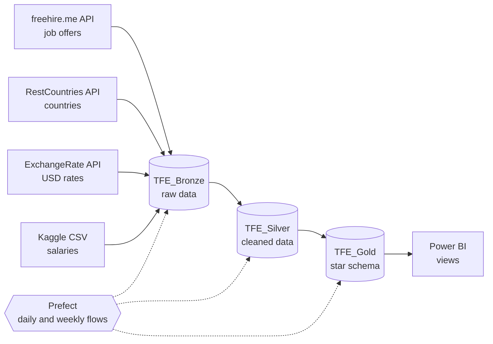

# Data Jobs Warehouse: tools, seniority and salaries across countries

**Final project of my Data Engineering training.** I designed a data warehouse for the international comparison of Data jobs (data engineer, data analyst, data scientist).

It answers three questions people ask when they look at this job market:

- **Which tools** should I master for each job?
- **What level of experience** do employers look for?
- **What salary** can I expect, by seniority and by country?

The answers come from several sources, and each one has its own format, so they cannot be compared directly. This project collects them, cleans them and organises them in a dimensional model that is ready for analysis in Power BI.

## Architecture

The pipeline follows a **Medallion architecture** (Bronze → Silver → Gold) on SQL Server, orchestrated with **Prefect**.



| Layer | Role |
|---|---|
| **Bronze** | Raw data, stored as received. It is append-only: rows are never updated or deleted. |
| **Silver** | Cleaning and transformation: deduplication, ISO country codes, skills extraction, salaries converted to USD. |
| **Gold** | Dimensional model: fact tables `fact_job` and `fact_salary`, dimensions (date, country, company, job, junk dimension), a skills bridge table and a load log (`etl_load_log`). |

## Key figures

- **20 countries**, 3 job categories (data engineering, data analytics, data science)
- **105,470 job offers** and **71,913 salary records** in the Gold layer
-  A daily incremental run takes about **27 minutes**. About **78 %** of that time is spent in the API collection (Bronze), because the API returns 100 offers per call and is queried page by page for each country.

## Features

- **Two load modes**
  - `full`: rebuilds everything, for the first load or after an incident.
  - `incremental`: processes only new or modified offers. It uses a watermark and stable identifiers, with no duplicates, in one transaction.
- **Orchestration with Prefect 3**: a daily flow (offers) and a weekly flow (countries and exchange rates), with automatic retries and run history.
- **Data quality checks** on the Gold layer (`05_gold_validation.sql`).
- **Power BI views** that answer the two business questions (`06_gold_views.sql`).
- **No secrets in the code**: the API key and the SQL Server name are read from environment variables.

## Tech stack

Python · pandas · SQLAlchemy · pyodbc · SQL Server (T-SQL) · Prefect 3 · REST APIs · Power BI

## Project structure

```
scripts/
├── db_config.py                         # SQL Server connection (environment variable)
├── 01a_bronze_freehire_api.py           # Bronze: job offers (REST API, pagination)
├── 01b_bronze_countries_api.py          # Bronze: countries (REST API, Bearer token)
├── 01c_bronze_taux_change_api.py        # Bronze: USD exchange rates (REST API)
├── 01d_bronze_salaries_csv.py           # Bronze: Kaggle salaries (flat file)
├── 02a_silver_taux_change.py            # Silver: exchange rates
├── 02b_silver_jobs_freehire.py          # Silver: offers, skills, bridge (full or incremental)
├── 02c_silver_country.py                # Silver: countries
├── 02d_silver_salary.py                 # Silver: salaries
├── 03_gold_creation_tables.sql          # Gold: dimensional model (DDL)
├── 04_gold_chargement.py                # Gold: full load
├── 04b_gold_chargement_incremental.py   # Gold: incremental load
├── 05_gold_validation.sql               # Gold: quality checks
├── 06_gold_views.sql                    # Gold: Power BI views
├── 07_run_pipeline.py                   # Orchestration in a single command
├── 08_prefect_flow.py                   # Orchestration with Prefect (schedules, retries)
└── data/                                # Kaggle CSV goes here (not versioned)
```

Code comments and console messages are written in French.

## How to run it

**Prerequisites:** Windows, SQL Server with three databases (`TFE_Bronze`, `TFE_Silver`, `TFE_Gold`), ODBC Driver 17 for SQL Server, and Python 3.12+.

```powershell
# 1. Install the dependencies
python -m venv venv
venv\Scripts\activate
pip install -r requirements.txt

# 2. Set the environment variables
setx SQL_SERVER "YOUR-SQL-SERVER-NAME"
setx RESTCOUNTRIES_API_KEY "your-api-key"

# 3. Bronze: collect the sources (put salaries.csv in scripts/data first)
cd scripts
python 01a_bronze_freehire_api.py
python 01b_bronze_countries_api.py
python 01c_bronze_taux_change_api.py
python 01d_bronze_salaries_csv.py

# 4. Gold: create the tables (run 03_gold_creation_tables.sql in SSMS), then
python 07_run_pipeline.py full

# 5. Daily run
python 07_run_pipeline.py incremental
# or with Prefect scheduling:
python 08_prefect_flow.py serve
```

## Data sources

- [freehire.me](https://freehire.me): job offers API
- [RestCountries](https://restcountries.com): country reference data
- [ExchangeRate-API](https://www.exchangerate-api.com): exchange rates (base USD)
- Kaggle: Data Science salaries dataset

The data itself is not included in this repository.

## Possible improvements

- Call the API in parallel to reduce the Bronze collection time.
- Move the warehouse to the cloud (Azure SQL or Databricks).
- Add automated tests for the transformations.

## Author

**Paul Gael**, Junior Data Engineer based in Brussels. [LinkedIn](https://www.linkedin.com/in/paul-nkomngog-633aa4390/)
